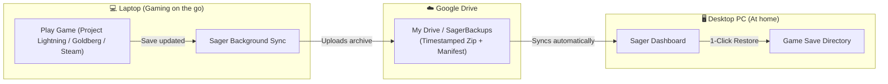

# 🎮 Sager - Game Companion & Cloud Save Sync

[](https://www.rust-lang.org/)
[](https://www.microsoft.com/windows)
[](LICENSE)
[](https://github.com/ybreakless/Sager)

> **Sager** is a lightweight, pure Rust Windows system tray companion that unifies **Steam & Project Lightning Achievement Notifications** with **Ludusavi-style Game Save Backup and Google Drive Cloud Synchronization**.

---

## 💡 Why Sager?

Gamers who use **Project Lightning**, **Goldberg Steam Emulator**, or games downloaded from alternative sources often have to juggle multiple separate utilities:
1. A third-party achievement notifier to see unlocks while playing.
2. A backup manager like **Ludusavi** to locate save directories.
3. Manual file copying or cloud uploaders to transfer progress between a **laptop** and a **desktop gaming PC**.

**Sager replaces all of these tools with a single, ultra-fast, zero-dependency Rust executable (~2 MB) that sits silently in your Windows System Tray.**

Whether you downloaded games from Project Lightning, Goldberg emulators, or native Steam, Sager tracks your achievements in real-time and ensures your game saves are always backed up to Google Drive and ready to restore on any PC with a single click.

---

## ✨ Features

### 🏆 1. Real-Time Achievement Notifier (Project Lightning & Steam)
- **Automatic File Watching**: Continuously monitors achievement databases from:
  - `%APPDATA%\Goldberg SteamEmu Saves\<AppID>\achievements.json`
  - `%LOCALAPPDATA%\ProjectLightning\` and `%APPDATA%\Project Lightning\`
  - Official Steam userdata and overlay stores
- **Native Windows Notifications**: Displays Windows tray balloon/toast alerts with game title, achievement name, description, and audio chime.
- **Achievement History**: Stores a timestamped archive of all unlocked achievements accessible via the dashboard.
- **Audio Chimes**: Plays a subtle Windows audio alert when an achievement unlocks.

### 💾 2. Ludusavi-Style Save Backup & Cross-PC Cloud Sync
- **Deep Save Directory Discovery**: Automatically scans PC save locations without manual configuration:
  - `%USERPROFILE%\Saved Games`
  - `%USERPROFILE%\Documents\My Games` and publisher folders (CD Projekt Red, etc.)
  - `%LOCALAPPDATA%` and `%APPDATA%`
  - Goldberg SteamEmu save directories
  - Steam Cloud Userdata (`<SteamPath>\userdata\<UserID>\<AppID>\remote`)
- **Automated Google Drive Sync**:
  - Automatically detects your Google Drive virtual drive (`G:\My Drive`, `H:\My Drive`) or desktop sync directory.
  - Generates compressed timestamped zip archives containing your save files and a `sager_manifest.json` metadata file.
  - Automatically runs background backups on a configurable schedule (e.g. every 60 minutes).
- **1-Click Cross-Device Restore**:
  - Back up on your laptop -> Google Drive syncs -> Click **Restore to PC** on your desktop.
  - Automatically creates a safety backup of any existing local saves before applying cloud saves.

### 🖥️ 3. Windows System Tray & Google Drive Integration
- **Custom "S" Logo Tray Icon**: Distinctive cyberpunk cyan-to-gold "S" monogram icon embedded directly into the Windows notification tray area.
- **Left-Click Tray Icon**: Instantly opens your preferred save directory / Google Drive folder in Windows Explorer.
- **Double-Click Tray Icon**: Instantly launches the Sager Web Dashboard.
- **Right-Click Context Menu**:
  - **Live Status Header**: Displays live active status, discovered games count, and unlocked trophy count.
  - **Discovered Games Submenu**: Interactive dropdown displaying all detected game titles — click any game to immediately back up that individual save to Google Drive!
  - **Live Google Drive Status**: Shows whether Google Drive for Desktop is Running, Stopped, or Not Installed.
  - **1-Click Google Drive Launch**: When Google Drive isn't running, start it directly from the tray or dashboard.
  - **Backup All Game Saves Now**: Trigger a full system backup on demand.
  - **Open Backup Folder**: Quick access to Google Drive archives.
  - **Test Achievement Alert**: Verify audio and tray notifications anytime.
  - **Open Dashboard**: Launch the local web interface.
  - **Exit Sager**: Clean tray icon removal and process termination.

### 🌐 4. Embedded Web Dashboard (`http://127.0.0.1:3939`)
- Built-in lightweight HTTP server serving a modern dark-mode interface:
  - **Status Strip**: Live Google Drive status with start button, backup target path, backup daily frequency, discovered games count, and total snapshots.
  - **Game Saves Table with Live Filter**: Real-time search bar to quickly find games, view categories and sizes, and back up individual titles.
  - **Cloud Restore Table**: List timestamped archives stored in Google Drive and restore them to your local PC.
  - **Achievement Feed**: Browse your trophies and unlock dates.
  - **Options & Daily Backup Schedule**:
    - Select how many times a day you want to save backups (`1x`, `2x`, `4x`, `12x`, `24x (Hourly)`, `48x`, or custom).
    - Audio chime preview test button (`🔊 Test Sound`).
    - Cloud directory and optional custom Google Drive executable paths.

---

## 🔄 Cross-PC Synchronization Workflow

How to keep your saves synchronized between your Laptop and Desktop:



1. **On your Laptop**:
   - Run Sager with the backup directory set to Google Drive (e.g., `G:\My Drive\SagerBackups`).
   - Sager automatically backs up your saves during gameplay.
2. **On your Desktop PC**:
   - Run Sager and open the Web Dashboard (`http://127.0.0.1:3939`).
   - In the **Cloud Backups for Restore** table, click **Restore to PC** next to any game.
   - Sager restores the save to the proper local PC path so you can pick up right where you left off!

---

## 🚀 Installation & Building

### Prerequisites
- Windows 10 or Windows 11 (64-bit)
- [Rust toolchain](https://rustup.rs/) (edition 2021)
- [Google Drive for Desktop](https://www.google.com/drive/download/) (optional, for cloud sync)

### Build from Source
```powershell
# Clone the repository
git clone https://github.com/ybreakless/Sager.git
cd Sager

# Build optimized release binary
cargo build --release
```
The compiled standalone executable will be located at:
```
target\release\sager.exe
```

### Launching Sager
Run the release binary directly or start it via PowerShell:
```powershell
.\target\release\sager.exe
```
The application will minimize into the Windows System Tray (near the clock).

---

## ⚡ Windows Startup Integration

To have Sager automatically launch silently whenever Windows starts:

1. Run the included PowerShell startup helper script:
```powershell
powershell -ExecutionPolicy Bypass -File .\scripts\install_startup.ps1
```
This creates a shortcut in `%APPDATA%\Microsoft\Windows\Start Menu\Programs\Startup\Sager.lnk` pointing to your compiled `sager.exe`.

---

## 📁 Project Architecture

```
Sager/
├── Cargo.toml                  # Zero heavyweight framework dependencies
├── LICENSE                     # MIT License
├── README.md                   # Documentation
├── scripts/
│   ├── install_startup.ps1     # Creates Windows Startup shortcut
│   └── start_sager.vbs         # Silent VBScript launcher
└── src/
    ├── main.rs                 # Thread coordination & Win32 message loop
    ├── config.rs               # Auto-detection for Google Drive, Steam, Goldberg & JSON config
    ├── tray.rs                 # Win32 System Tray icon, context menu, & notifications
    ├── achievements/
    │   ├── mod.rs
    │   ├── models.rs           # Achievement data structures
    │   ├── watcher.rs          # Real-time filesystem scanner for emulators & Steam
    │   └── history.rs          # Persistent JSON storage for unlocked trophies
    ├── backup/
    │   ├── mod.rs
    │   ├── scanner.rs          # Ludusavi-style save directory discovery engine
    │   ├── archiver.rs         # Zip compression & manifest generation
    │   └── restore.rs          # Safe extraction & pre-restore safety backups
    └── web/
        ├── mod.rs
        ├── server.rs           # Embedded HTTP REST API server (tiny_http)
        └── ui.rs               # Dark-mode dashboard (HTML/CSS/JS)
```

---

## 🤝 Contributing & Git Workflow

Sager uses a professional git workflow with feature branches:
- `main`: Production-ready releases
- `develop`: Ongoing development
- `feature/*`: Dedicated branches for new features

```powershell
git checkout -b feature/your-feature-name
# Make your changes
git commit -m "feat(module): description of feature"
```

---

## 📜 License

This project is licensed under the [MIT License](LICENSE).
