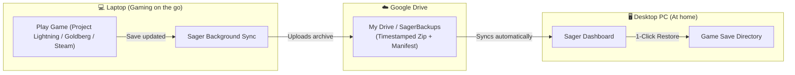

<p align="center">
  
</p>
<h1 align="center">Sager - Game Companion & Cloud Save Sync</h1>
<p align="center">
  <a href="https://www.rust-lang.org/"></a>
  <a href="https://www.microsoft.com/windows"></a>
  <a href="android/"></a>
  <a href="LICENSE"></a>
  <a href="https://github.com/sponsors/ybreakless"></a>
  <a href="https://github.com/ybreakless/Sager"></a>
</p>

> **Sager** is a lightweight, pure Rust Windows system tray companion that unifies **Steam & Project Lightning Achievement Notifications** with **Ludusavi-style Game Save Backup and Google Drive Cloud Synchronization**, paired with a **Pocket Android Companion** for local home Wi-Fi sync!

---

## 💡 Why Sager?

Gamers who use **Project Lightning**, **Goldberg Steam Emulator**, or games downloaded from alternative sources often have to juggle multiple separate utilities:
1. A third-party achievement notifier to see unlocks while playing.
2. A backup manager like **Ludusavi** to locate save directories.
3. Manual file copying or cloud uploaders to transfer progress between a **laptop** and a **desktop gaming PC**.

**Sager replaces all of these tools with a single, ultra-fast, zero-dependency Rust executable (~2 MB) that sits silently in your Windows System Tray.**

Whether you downloaded games from Project Lightning, Goldberg emulators, or native Steam, Sager tracks your achievements in real-time and ensures your game saves are always backed up to Google Drive and ready to restore on any PC with a single click.

---

## ✨ Features

### 🛡️ 1. ProtonVPN-Style System Tray Companion & Dual Views
- **Single Left-Click Tray Activation**: Clicking the tray icon instantly brings up the sleek ProtonVPN-style desktop companion interface.
- **Dual View Modes**:
  - `📱 Tray Mode`: Ultra-compact (480px) widget view inspired by ProtonVPN, anchored for quick status checks, one-click backups, and instant toggle switches.
  - `🖥️ Studio Mode`: Widescreen responsive desktop suite for in-depth save exploration, restore operations, and diagnostics.
- **Run in Background & Make Appear Controls**:
  - **Header & Switchboard Buttons**: Instant `[ 🛡️ Run in Background ]` button hides the console window into the tray with confirmation modal; `[ 👁️ Make Appear ]` restores console and UI to the foreground.
  - **Dynamic Tray Menu Options**: Right-click tray menu dynamically toggles between `🕶️ Run in Background (Hide Console)` and `👁️ Make Console Appear (Show Window)`.
  - **Silent CLI Flags**: Launch with `sager.exe --background` (or `--silent`, `-b`, `--hide`) to boot immediately into the system tray without any console window popup.
  - **One-Click Windows Boot Toggle**: Direct switch in the companion view to enable or disable automatic silent startup (`%APPDATA%\...\Startup\Sager.lnk`).
  - **Helper Scripts**: `launch_background.bat` (silent launch) and `make_appear.bat` (instant reveal and dashboard launch).
- **One-Click Hero Action**: Giant `BACKUP ALL GAMES TO GOOGLE DRIVE` button with status animation.
- **Quick Controls Switchboard**:
  - Auto-Backup Saves (Toggle Switch)
  - Daily Backup Frequency selector (`1x`, `6x`, `12x`, `24x Hourly ⭐`, `48x`)
  - Audio Chimes & Windows Desktop Alerts (Toggle Switches)
  - Preferred Game Launcher selector (Goldberg, Steam, Project Lightning, Custom)
  - In-Launcher Achievement Sync (Toggle Switch)

### 🏆 2. Authentic Steam In-Game Overlay, Sound & Achievement Matrix
- **Official Steam Notification Audio (`deck_ui_achievement_toast.wav`)**: Embedded authentic Steam achievement unlock chime, played asynchronously in-memory on Windows with zero disk latency.
- **Steam TopMost In-Game Overlay Toast**:
  - Borderless, topmost overlay window styled identically to Steam (`#1b2838` charcoal navy, `#66c0f4` glowing cyan accent, bold white title, gold trophy badge).
  - Designed specifically for PC gaming: uses `WS_EX_TOPMOST | WS_EX_NOACTIVATE` so it appears seamlessly over borderless and fullscreen games without stealing keyboard or controller input!
- **Local Trophy Showcase & In-Game Replay**:
  - Displays all unlocked trophies locally with exact unlock timestamps, descriptions, and launcher origin.
  - Interactive `[ 🔔 Pop Overlay ]` button on each trophy to replay the in-game toast and authentic chime on demand.
  - `[ 🎮 Open in Steam ]` button that launches the native Steam client achievement hub (`steam://open/achievements/<appid>`).
- **Automatic Goldberg & Project Lightning Save Sync**:
  - Automatically writes unlocked achievements to `%APPDATA%\Goldberg SteamEmu Saves\<AppID>\achievements.json` with timestamped records.
  - Keeps local saves in `sager_achievements.json` for cross-PC restoration via Google Drive.
- **Visual Progress Bar & Metrics**: Displays total achievements, unlocked count, locked count, and completion percentage (e.g. `LEGO Batman: 2 of 64 Unlocked (3.1%)`).
- **Interactive Filter Pills**: Instantly toggle between `All`, `🏆 Unlocked`, and `🔒 Locked / Pending`.
- **Real-Time Search Bar**: Search achievements across all games by title, description, or internal ID.

### 💾 3. Deep Game Save Discovery & Cross-PC Cloud Sync
- **23+ Detected Save Locations Out-of-the-Box**:
  - `LEGO Batman: Legacy of the Dark Knight` (`%LOCALAPPDATA%\Warner Bros. Interactive Entertainment\...`)
  - `The Invincible` (`%LOCALAPPDATA%\TheInvincible\Saved\SaveGames`)
  - `Clair Obscur: Expedition 33` (`%LOCALAPPDATA%\Sandfall\Saved\SaveGames`)
  - `F1 25` (`%LOCALAPPDATA%\F1 25\savegame`)
  - `Bodycam` (`%LOCALAPPDATA%\Bodycam\Saved\SaveGames`)
  - `The Last of Us Part I` & `Uncharted` (`%USERPROFILE%\Saved Games`)
  - `Assassin's Creed Shadows` (Ubisoft & Goldberg Uplay)
  - `Assetto Corsa Competizione` (`%LOCALAPPDATA%\AC2`)
  - `CD Projekt Red` (Witcher / Cyberpunk)
  - Steam Cloud Userdata (`BioShock Infinite`, `Portal 2`, `Resident Evil 6`, `Wallpaper Engine`)
- **Automated Google Drive Sync**:
  - Automatic detection of Google Drive for Desktop (`G:\My Drive` / `H:\My Drive`).
  - Compressed timestamped zip archives with JSON manifests.
- **1-Click Restore with Zero Data Loss Guarantee**:
  - Automatically creates a timestamped safety backup of your existing local save before applying cloud restores.

### 🖥️ 3. Windows System Tray & Google Drive Integration
- **Custom "S" Logo Tray Icon**: Distinctive cyberpunk cyan-to-gold "S" monogram icon embedded directly into the Windows notification tray area.
- **Left-Click Tray Icon**: Instantly opens your preferred save directory / Google Drive folder in Windows Explorer.
- **Double-Click Tray Icon**: Instantly launches the Sager Web Dashboard.
- **Right-Click Context Menu**:
  - **Live Status Header**: Displays live active status, discovered games count, and unlocked trophy count.
  - **Discovered Games Submenu**: Interactive dropdown displaying all detected game titles — click any game to immediately back up that individual save to Google Drive!
  - **Live Google Drive Status**: Shows whether Google Drive for Desktop is Running, Stopped, or Not Installed.
  - **1-Click Google Drive Launch**: When Google Drive isn't running, start it directly from the tray or dashboard.
  - **Backup All Game Saves Now**: Trigger a full system backup on demand.
  - **Open Backup Folder**: Quick access to Google Drive archives.
  - **Test Achievement Alert**: Verify audio and tray notifications anytime.
  - **Open Dashboard**: Launch the local web interface.
  - **Exit Sager**: Clean tray icon removal and process termination.

### 🌐 4. Embedded Web Dashboard (`http://127.0.0.1:3939`)
- Built-in lightweight HTTP server serving a modern dark-mode interface:
  - **Status Strip**: Live Google Drive status with start button, backup target path, backup daily frequency, discovered games count, and total snapshots.
  - **Game Saves Table with Live Filter**: Real-time search bar to quickly find games, view categories and sizes, and back up individual titles.
  - **Cloud Restore Table**: List timestamped archives stored in Google Drive and restore them to your local PC.
  - **Achievement Feed**: Browse your trophies and unlock dates.
  - **Options & Daily Backup Schedule**:
    - Select how many times a day you want to save backups (`1x`, `2x`, `4x`, `12x`, `24x (Hourly)`, `48x`, or custom).
    - Audio chime preview test button (`🔊 Test Sound`).
    - Cloud directory and optional custom Google Drive executable paths.

### 🧪 5. Interactive Test Center & Diagnostic Suite
- **Full System Health Check**: One-click benchmark of all 7 subsystems (Google Drive write latency, emulator paths, scanner count, archives, audio, startup).
- **Live Terminal & Activity Console**: Real-time scrolling event log displaying color-coded status, write speeds, backup actions, and achievement toasts.
- **Custom Achievement Simulator**: Test Windows tray toast alerts with customized game names and titles before playing.
- **Google Drive Latency Benchmark**: Live disk write/read/cleanup test measuring cloud sync latency in milliseconds.
- **Convenient Launchers**:
  - Double-click [`launch_dashboard.bat`](launch_dashboard.bat) to open the UI instantly in your default browser.
  - Run `sager.exe --ui` to start Sager and open the dashboard immediately.

### 📱 6. Sager Android Companion & Local Home Wi-Fi Sync
- **Carry Your Trophies Everywhere**: Native Android app (Jetpack Compose) caches all your unlocked achievements offline on your phone. Proudly show off your gaming achievements to friends anywhere with zero cellular/internet data needed!
- **Local Home Wi-Fi Sync**: When you get home and connect to Wi-Fi, tap `[ ⚡ Sync Now ]`. The Android app connects directly to your desktop (`http://<PC_IP>:3939/api/mobile/sync`) over your home network and updates all progress in seconds.
- **Zero Third-Party Cloud**: 100% private, peer-to-peer on your home LAN. No logins, accounts, or telemetry.
- **Show-Off Celebration Mode**: Tap any trophy in the app to open a fullscreen celebration card with golden trophy animation and achievement metrics.

### 📦 7. Sager Vault Export & Import (Cross-PC Portability)
- **1-Click Vault Export**: Download your entire gaming progression (achievements, discovered games, backup schedule, manifests) into a single portable `.json` bundle.
- **Intelligent Vault Import**: Seamlessly import vault bundles on a new PC or Android phone with automatic merge and zero data loss.

---

## 🔄 Cross-PC Synchronization Workflow

How to keep your saves synchronized between your Laptop and Desktop:



1. **On your Laptop**:
   - Run Sager with the backup directory set to Google Drive (e.g., `G:\My Drive\SagerBackups`).
   - Sager automatically backs up your saves during gameplay.
2. **On your Desktop PC**:
   - Run Sager and open the Web Dashboard (`http://127.0.0.1:3939`).
   - In the **Cloud Backups for Restore** table, click **Restore to PC** next to any game.
   - Sager restores the save to the proper local PC path so you can pick up right where you left off!

---

## 🚀 Installation & Building

### Prerequisites
- Windows 10 or Windows 11 (64-bit)
- [Rust toolchain](https://rustup.rs/) (edition 2021)
- [Google Drive for Desktop](https://www.google.com/drive/download/) (optional, for cloud sync)

### Build from Source
```powershell
# Clone the repository
git clone https://github.com/ybreakless/Sager.git
cd Sager

# Build optimized release binary
cargo build --release
```
The compiled standalone executable will be located at:
```
target\release\sager.exe
```

### Launching Sager
Sager is compiled as a native **Windows GUI subsystem application** (`#![windows_subsystem = "windows"]`). When launched, it starts **completely windowless** — no terminal or command prompt window ever opens or lingers on your desktop:

- **Automatic Startup on Boot**: On first launch, Sager automatically configures itself in your Windows Startup folder (`%APPDATA%\Microsoft\Windows\Start Menu\Programs\Startup\Sager.lnk`). Sager will start silently into the system tray every time Windows boots, requiring zero manual commands or setup.
- **Double-Click Execution**: Double-clicking `sager.exe` launches the tray companion instantly without opening any console window.
- **Companion UI**: Double-clicking the tray icon or running `sager.exe --ui` opens the sleek companion dashboard in your default browser.
- **Developer Debug Mode**: If you explicitly want to view live stdout/stderr terminal logs, run `sager.exe --console` or `sager.exe --debug` in an existing PowerShell or CMD window.

You can also use the included 1-click batch scripts:
- `launch_background.bat`: Launches Sager silently in the Windows system tray.
- `make_appear.bat`: Brings up the web companion dashboard immediately.
- `launch_dashboard.bat`: Starts Sager and opens the browser interface.

---

## ⚡ Windowless Automation & Ultra-Low Resource Footprint

Sager is engineered from the ground up in pure Rust to be as lightweight and non-intrusive as possible:

| Metric | Sager | Typical Electron / Web App |
|---|---|---|
| **Resident RAM (Working Set)** | **~9.4 MB** | 150 MB - 350 MB |
| **Idle CPU Usage** | **0.0%** (Cached filesystem `mtime`) | 0.5% - 2.0% |
| **Terminal / Console Window** | **Zero (Native GUI Subsystem)** | Lingering command prompt or background wrapper |
| **Startup Behavior** | **Automatic Silent Boot** (`Startup\Sager.lnk`) | Manual bat files or scheduled tasks |
| **Disk I/O** | **Smart Differential** (Skips unchanged saves) | Full re-compression every interval |
| **Standalone Binary Size** | **~1.8 MB** (LTO & stripped) | 80 MB - 120 MB |

- **Zero-Terminal Windowless Subsystem**: Uses Win32 `/SUBSYSTEM:WINDOWS` so double-clicking or booting produces zero terminal flashes or lingering windows.
- **Filesystem `mtime` Timestamp Caching**: `AchievementWatcher` checks the NTFS/FAT32 modified timestamp directly via `fs::metadata` before reading or parsing `achievements.json`. If no changes occurred, disk I/O and JSON deserialization are completely bypassed, dropping idle CPU usage to 0.0%.
- **Differential Save Archiving**: `SaveArchiver` inspects the newest save modification timestamp against `latest.json` manifests. Unchanged games are skipped during periodic auto-backups, saving disk wear and Google Drive bandwidth.
- **Windows Boot Control**: Toggle automatic startup anytime directly in the web companion interface via the `🚀 Windows Startup` button or via `/api/system/toggle-startup`.

---

## 📦 Releases & Downloads

Ready-to-use release packages are maintained in the [GitHub Releases](https://github.com/ybreakless/Sager/releases) tab:

| Release Asset | Platform | Description | Size |
|---|---|---|---|
| [**`sager.exe`**](releases/v0.2.0/sager.exe) | Windows 10 / 11 (x64) | **Direct Standalone Executable**: Native GUI subsystem, windowless tray execution & auto-startup | ~1.8 MB |
| [**`SagerLauncher.exe`**](releases/v0.2.0/SagerLauncher.exe) | Windows 10 / 11 (x64) | **Minimal Setup & Launcher**: Downloads Sager from GitHub, installs to AppData, and configures Windows Startup with 1 click | ~390 KB |
| [**`sager-companion-v0.2.0.apk`**](releases/v0.2.0/sager-companion-v0.2.0.apk) | Android 7.0+ (API 24+) | **Ready-to-Install Android APK**: Minimal black & white offline trophy vault with local home Wi-Fi sync | ~11.9 MB |
| [**`sager-v0.2.0-windows-x64.zip`**](releases/v0.2.0/sager-v0.2.0-windows-x64.zip) | Windows 10 / 11 (x64) | Complete Windows release archive containing `sager.exe`, `SagerLauncher.exe`, batch scripts & audio | ~1.48 MB |
| [**`sager-companion-v0.2.0-android.zip`**](releases/v0.2.0/sager-companion-v0.2.0-android.zip) | Android 7.0+ (API 24+) | Full Android Jetpack Compose companion source project | ~111 KB |

---

### 📥 Installing with SagerLauncher (Windows)
1. Download [**`SagerLauncher.exe`**](releases/v0.2.0/SagerLauncher.exe) from GitHub Releases.
2. Run `SagerLauncher.exe` — a minimal black & white control dialog will appear.
3. Click **`⬇ Download & Install Sager`**:
   - Automatically downloads or installs Sager into `%LOCALAPPDATA%\Sager\`.
   - Creates a clean desktop shortcut.
   - Automatically adds Sager to Windows Startup (`%APPDATA%\...\Startup\Sager.lnk`).
4. Click **`🎮 Launch Sager`** to start gaming!

---

### 📱 Installing Sager Android Companion (Android)
1. Download [**`sager-companion-v0.2.0.apk`**](releases/v0.2.0/sager-companion-v0.2.0.apk) on your Android phone.
2. Tap the APK to install (enable "Install unknown apps" if prompted).
3. Open the app to enjoy your minimal black & white offline trophy vault.
4. When on your home Wi-Fi network, tap **`SYNC NOW`** to pull all unlocked achievements from your PC!

---

## 💖 Support Sager on GitHub Sponsors

Sager is free, open-source, local-first, zero-telemetry software built for the gaming community. If Sager saves you time or enhances your gaming setup, please consider sponsoring development:

👉 **[Sponsor @ybreakless on GitHub Sponsors](https://github.com/sponsors/ybreakless)**

| Sponsorship Tier | Monthly | Perks & Benefits |
|---|---|---|
| **⚡ Supporter** | **\$5 / month** | Name listed in GitHub Backers & `README.md`, exclusive supporter badge. |
| **🎮 Power Gamer** | **\$15 / month** | Priority requests for new game save locations & emulators, voting on the roadmap. |
| **🚀 Pro Sponsor** | **\$50 / month** | Direct 1-on-1 assistance for custom backup setups, project logo on README. |
| **👑 Champion** | **\$100 / month** | Permanent sponsor credit, dedicated feature sponsorship, direct priority support. |

---

## 📁 Project Architecture

```
Sager/
├── Cargo.toml                  # Zero heavyweight framework dependencies
├── LICENSE                     # MIT License
├── README.md                   # Documentation
├── .github/
│   └── FUNDING.yml             # GitHub Sponsors configuration
├── android/                    # Sager Android Companion App (Jetpack Compose)
│   ├── app/
│   │   ├── src/main/kotlin/com/ybreakless/sager/
│   │   │   ├── model/          # Offline achievement & game data models
│   │   │   ├── data/           # Offline cache repository & LAN sync
│   │   │   └── ui/main/        # Steam Deck-inspired Jetpack Compose UI
│   │   └── build.gradle.kts
│   └── build.gradle.kts
├── releases/
│   └── v0.2.0/                 # Release packages & notes
├── scripts/
│   ├── install_startup.ps1     # Creates Windows Startup shortcut
│   └── start_sager.vbs         # Silent VBScript launcher
└── src/
    ├── main.rs                 # Thread coordination & Win32 message loop
    ├── audio.rs                # In-memory Win32 PlaySound for Steam chime
    ├── config.rs               # Auto-detection for Google Drive, Steam, Goldberg & JSON config
    ├── overlay.rs              # TopMost in-game overlay toast window (WS_EX_TOPMOST)
    ├── tray.rs                 # Win32 System Tray icon, context menu, & notifications
    ├── achievements/
    │   ├── mod.rs
    │   ├── catalog.rs          # Steam manifest & achievement definition database
    │   ├── history.rs          # Persistent JSON storage & Goldberg sync
    │   ├── models.rs           # Achievement data structures
    │   └── watcher.rs          # Real-time filesystem scanner for emulators & Steam
    ├── backup/
    │   ├── mod.rs
    │   ├── scanner.rs          # Ludusavi-style save directory discovery engine
    │   ├── archiver.rs         # Zip compression & manifest generation
    │   └── restore.rs          # Safe extraction & pre-restore safety backups
    └── web/
        ├── mod.rs
        ├── server.rs           # Embedded HTTP REST API & Mobile LAN sync server
        └── ui.rs               # Responsive ProtonVPN-style dashboard & vault manager
```

---

## 🤝 Contributing & Git Workflow

Sager uses a professional git workflow with feature branches:
- `main`: Production-ready releases
- `develop`: Ongoing development
- `feature/*`: Dedicated branches for new features

```powershell
git checkout -b feature/your-feature-name
# Make your changes
git commit -m "feat(module): description of feature"
```

---

## 📜 License

This project is licensed under the [MIT License](LICENSE).
