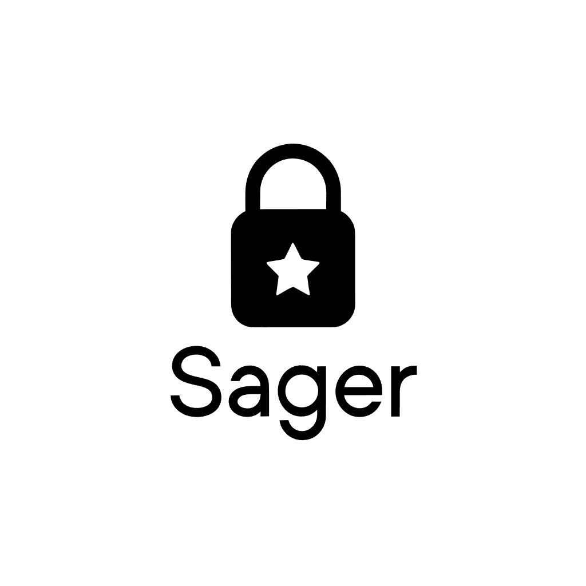

# Sager v0.2.0 — Authentic Steam In-Game Overlay, Pocket Android Companion & Vault Portability

  

We are thrilled to announce **Sager v0.2.0**! This major release delivers the official Steam achievement notification experience directly over your PC games, introduces the **Sager Android Companion** app with offline trophy showcase and local Home Wi-Fi sync, and adds a full **Vault Export & Import** engine for seamless cross-PC portability.

---

## 🌟 Highlights & New Features

### 1. 🎮 Authentic Steam In-Game TopMost Overlay & Official Chime
- **Official Steam Audio (`deck_ui_achievement_toast.wav`)**: Embedded directly into the lightweight Rust binary, playing asynchronously via Win32 `PlaySound` from memory with zero disk lag.
- **TopMost In-Game Toast (`WS_EX_TOPMOST | WS_EX_NOACTIVATE`)**: Appears on top of active DirectX, borderless, and fullscreen games without stealing keyboard or controller input!
- **Sleek Steam Deck Charcoal Design**: Dark navy `#1b2838` background, glowing `#66c0f4` cyan accent line, bold white typography, and gold trophy badge.
- **Interactive Replay**: Click `[ 🔔 Pop Overlay ]` on any earned achievement in your dashboard to test or replay the toast anytime.

### 2. 📱 Sager Android Companion & Home Wi-Fi Sync (`android/`)
- **Carry Your Trophies Everywhere**: Sager Android caches your entire unlocked achievement catalog offline on your phone so you can show off your gaming feats to friends anywhere without internet.
- **Local Home Wi-Fi Sync**: When you get home, tap **⚡ Sync Now**. Sager Android connects directly to your desktop over local LAN (`http://<PC_IP>:3939/api/mobile/sync`) and pulls the latest unlocks in seconds!
- **Zero Cloud Middleman**: 100% private, peer-to-peer over your local network. No external servers or account creation required.

### 3. 📦 Vault Export & Import / Cross-PC Portability
- **1-Click Vault Export**: Export your complete trophy history, discovered game catalogs, and backup manifests into a single `.json` / `.sager` bundle.
- **Intelligent Vault Import**: Safely import and merge achievements from another gaming PC, previous installation, or phone with zero data loss.
- **Direct Steam Client Launch**: 1-click `[ 🎮 Open in Steam ]` button launching `steam://open/achievements/<appid>`.

### 4. ⚡ Zero-Terminal Windowless Automation & Ultra-Low Resource Usage
- **Native Windows GUI Subsystem (`#![windows_subsystem = "windows"]`)**: Zero terminal or command prompt window opens or lingers on your desktop. Sager runs as a pure background system tray process.
- **Automatic Silent Windows Boot**: On first launch, Sager places a silent startup shortcut in `%APPDATA%\Microsoft\Windows\Start Menu\Programs\Startup\Sager.lnk` so it runs automatically in the tray every time Windows boots.
- **Ultra-Low Memory Footprint**: Uses only **~9.4 MB RAM**, compared to 200MB+ for Electron-based utilities.
- **Zero Idle CPU**: File watcher caches file modification timestamps (`mtime`) directly via the filesystem, avoiding unnecessary disk reads and JSON parsing when no achievements have changed.
- **Smart Differential Backup**: Saves are only compressed to Google Drive if the save directory was modified since the previous snapshot, saving disk cycles and cloud upload bandwidth.
- **Developer Console Mode**: If you need live stdout logs, launch with `sager.exe --console` or `--debug`.

---

## 📦 Downloads & Release Assets

| Asset | Platform | Description | Size |
|---|---|---|---|
| [**`sager-v0.2.0-windows-x64.zip`**](sager-v0.2.0-windows-x64.zip) | Windows 10 / 11 (x64) | Standalone executable, tray companion, batch launchers & assets | ~1.5 MB |
| [**`sager-companion-v0.2.0-android.zip`**](sager-companion-v0.2.0-android.zip) | Android 7.0+ (API 24+) | Android Jetpack Compose Companion App project & offline vault | ~111 KB |

---

## 💖 Sponsor Sager on GitHub

Sager is free, open-source, zero-telemetry, and built in pure Rust. If Sager saves you time or enhances your gaming setup, please consider sponsoring development:

👉 **[Sponsor @ybreakless on GitHub Sponsors](https://github.com/sponsors/ybreakless)**
- **⚡ Supporter ($5/mo)**: Support independent open-source gaming tools & get recognized in `README.md`.
- **🎮 Power Gamer ($15/mo)**: Priority feature requests & voting on supported games.
- **🚀 Sponsor Tier ($50/mo)**: Direct assistance, custom emulator scripts & logo featured.

---

**Full Changelog**: https://github.com/ybreakless/Sager/compare/v0.1.0...v0.2.0
